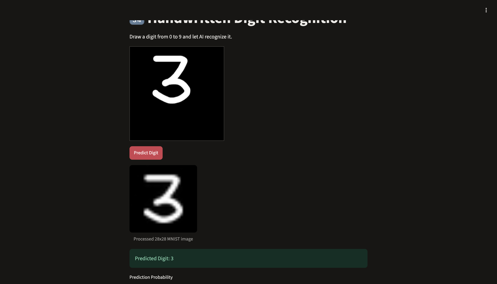
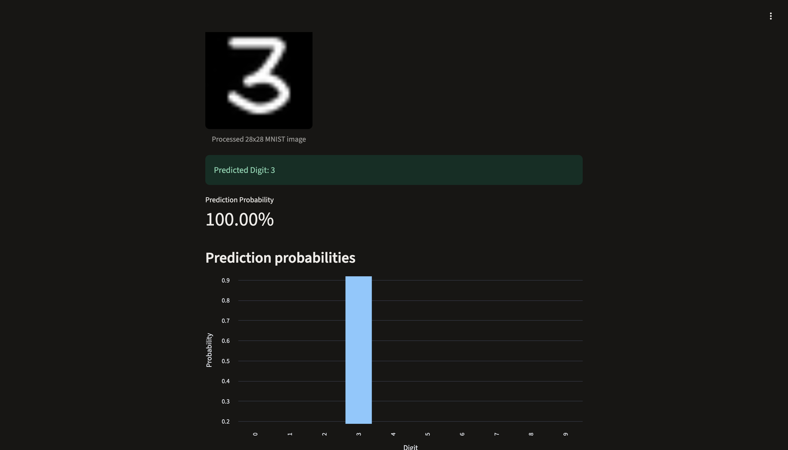
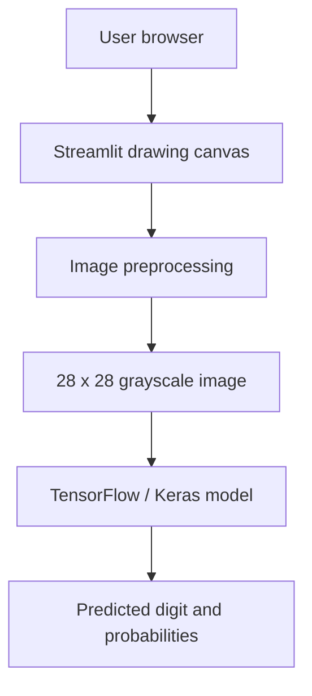
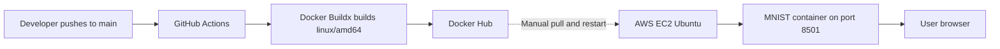

# MNIST Handwritten Digit Recognition

A containerized handwritten-digit recognition application built with TensorFlow/Keras and Streamlit, packaged with Docker, published to Docker Hub through GitHub Actions, and deployed on an AWS EC2 Ubuntu instance.

[](https://github.com/vaishnavritik/mnist-digit-recognition/actions/workflows/docker-build.yml)
[](https://hub.docker.com/r/vasrivastava/mnist-digit-recognition)

## Project overview

The application lets a user draw a digit (0–9) on a browser canvas. It preprocesses the drawing into the MNIST model's 28×28 grayscale input format and returns the predicted digit, prediction probability, and class probabilities.

### Highlights

- Trained a feed-forward neural network on the MNIST dataset.
- Achieved approximately **97.79% test accuracy** in the training experiment.
- Built an interactive Streamlit drawing interface.
- Added preprocessing to crop, resize while preserving aspect ratio, center, and normalize the drawn digit.
- Saved and loaded the trained Keras model from `mnist_digit_model.keras`.
- Containerized the application using Docker.
- Published a Linux AMD64 image to Docker Hub.
- Deployed the container on Ubuntu 26.04 LTS running on AWS EC2.
- Configured GitHub Actions to build and publish Docker images when code is pushed to `main`.

## Screenshots

### Drawing interface and model input preprocessing



### Prediction result



> The displayed 100.00% value is the model's maximum softmax output for this example; it should not be interpreted as a calibrated measure of real-world certainty.

## Architecture

### Application inference flow



### Build and deployment flow



> Deployment scope: GitHub Actions automates Docker image building and publishing. The EC2 image pull and container replacement were performed manually; automatic EC2 deployment is a planned improvement, not part of the current pipeline.

## Technology stack

- **Language:** Python
- **ML framework:** TensorFlow / Keras
- **UI:** Streamlit, streamlit-drawable-canvas
- **Image processing:** Pillow, NumPy
- **Containerization:** Docker
- **CI:** GitHub Actions
- **Image registry:** Docker Hub
- **Cloud deployment:** AWS EC2 (Ubuntu, Linux AMD64)

## Resume highlights

**MNIST Handwritten Digit Recognition – Cloud Deployment & CI/CD**

**Technologies:** Python, TensorFlow, Keras, Streamlit, Docker, Docker Hub, GitHub Actions, AWS EC2, Linux.

- Developed and containerized a handwritten digit recognition application using TensorFlow/Keras and Streamlit, achieving approximately 97.79% test accuracy.
- Built and published Docker images for Linux AMD64 to Docker Hub.
- Deployed the containerized ML application on AWS EC2 running Ubuntu Linux and configured application access through Docker port mapping.
- Implemented a GitHub Actions workflow to automatically build and publish versioned Docker images to Docker Hub on pushes to the `main` branch.
- Troubleshot ARM64 vs AMD64 image compatibility and deployed the AMD64 image successfully on AWS EC2.

**GitHub:** [vaishnavritik/mnist-digit-recognition](https://github.com/vaishnavritik/mnist-digit-recognition)

> Accuracy is the observed test-set result from the training notebook. CI currently builds and publishes images; EC2 rollout is manual.

## Repository structure

```text
.
├── app.py
├── mnist_digit_model.keras
├── MNIST_Digit_Recognition.ipynb
├── requirements.txt
├── Dockerfile
├── .dockerignore
├── .gitignore
├── screenshots/
│   ├── mnist-drawing-interface.png
│   └── mnist-prediction-result.png
└── .github/
    └── workflows/
        └── docker-build.yml
```

## Run locally

### 1. Clone the repository

```bash
git clone https://github.com/vaishnavritik/mnist-digit-recognition.git
cd mnist-digit-recognition
```

### 2. Create and activate a virtual environment

macOS / Linux:

```bash
python3 -m venv .venv
source .venv/bin/activate
```

### 3. Install dependencies and start Streamlit

```bash
python -m pip install --upgrade pip
pip install -r requirements.txt
python -m streamlit run app.py
```

Open [http://localhost:8501](http://localhost:8501).

## Run with Docker

Build the image:

```bash
docker build -t mnist-digit-recognition:local .
```

Run the container:

```bash
docker run --rm -p 8501:8501 mnist-digit-recognition:local
```

Open [http://localhost:8501](http://localhost:8501).

## Docker Hub

Image repository: [vasrivastava/mnist-digit-recognition](https://hub.docker.com/r/vasrivastava/mnist-digit-recognition)

Pull and run the published image:

```bash
docker pull vasrivastava/mnist-digit-recognition:latest
docker run -d --name mnist-app -p 8501:8501 \
  vasrivastava/mnist-digit-recognition:latest
```

## CI workflow

The workflow at `.github/workflows/docker-build.yml`:

1. Runs on pushes to the `main` branch or manual dispatch.
2. Checks out the repository.
3. Configures Docker Buildx.
4. Authenticates to Docker Hub using GitHub repository secrets.
5. Builds a `linux/amd64` image.
6. Publishes `latest` and commit-specific image tags.

Required GitHub Actions repository secrets:

- `DOCKERHUB_USERNAME`
- `DOCKERHUB_TOKEN`

Never commit registry tokens, cloud credentials, private keys, or other secrets to the repository.

## AWS deployment notes

The application was deployed as a Docker container on an Ubuntu EC2 instance, with container port 8501 published to the host.

For safer access:
- Restrict inbound TCP/8501 in the EC2 security group to trusted IP addresses.
- Avoid exposing the Streamlit port publicly without authentication and HTTPS.
- Use a reverse proxy and TLS for a production-facing deployment.
- Monitor EC2 memory and CPU usage; TensorFlow can be resource-intensive on small instances.
- Stop or terminate test infrastructure when it is not needed to control cloud costs.

## Future improvements

- Add automated tests for preprocessing and prediction.
- Add a CI test job before the Docker build.
- Automate EC2 deployment using a restricted deployment identity and SSH or AWS Systems Manager.
- Add HTTPS, authentication, and a domain name.
- Add CloudWatch monitoring and container health checks.
- Pin all Python dependencies for reproducible builds.
- Evaluate model performance on user-drawn samples and improve preprocessing if needed.

## Author

**Vaishnav Srivastava**

- GitHub: [@vaishnavritik](https://github.com/vaishnavritik)
- Project: [mnist-digit-recognition](https://github.com/vaishnavritik/mnist-digit-recognition)
